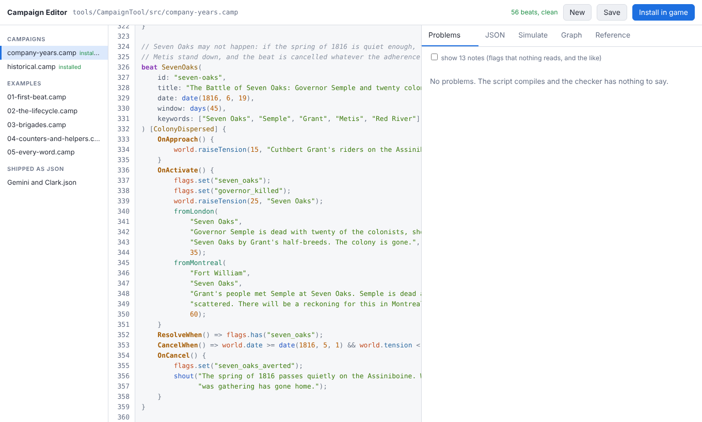
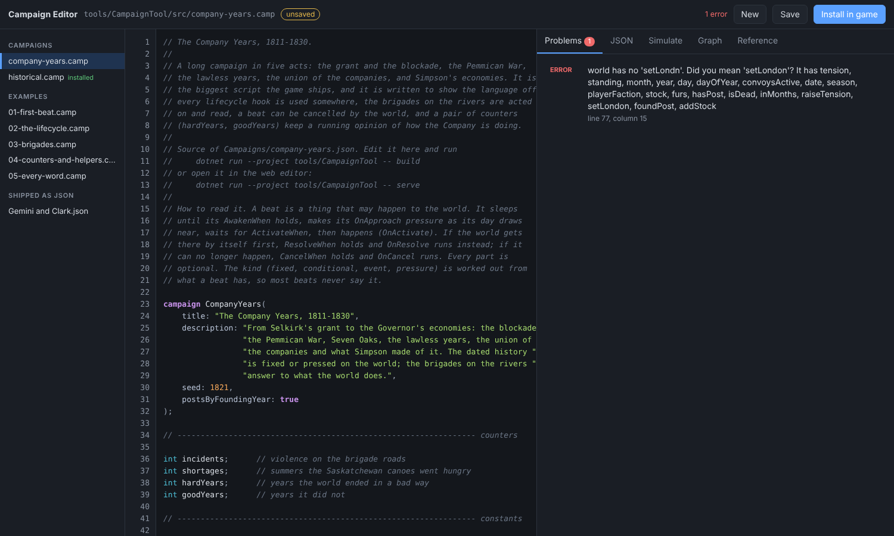
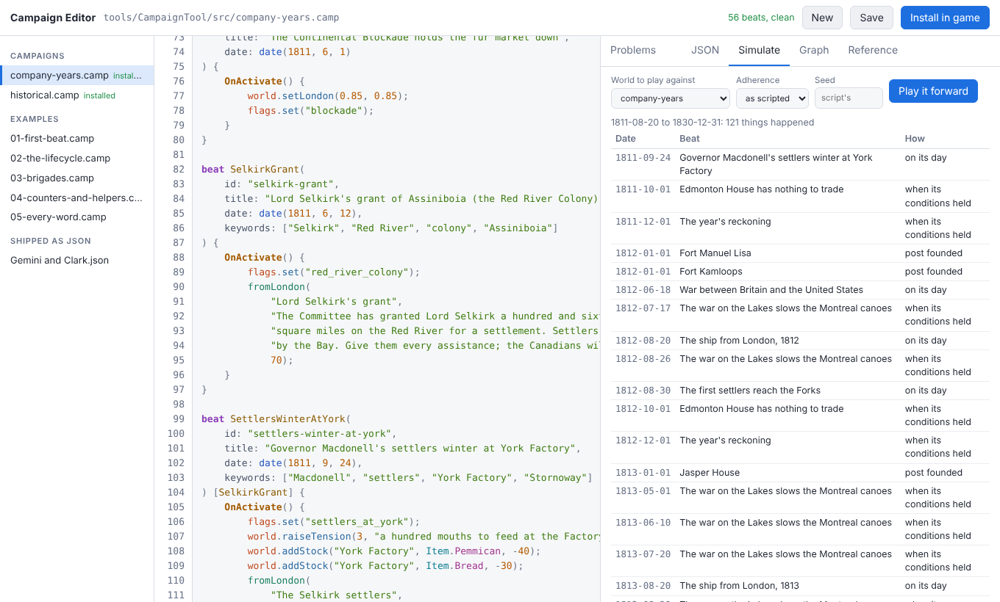
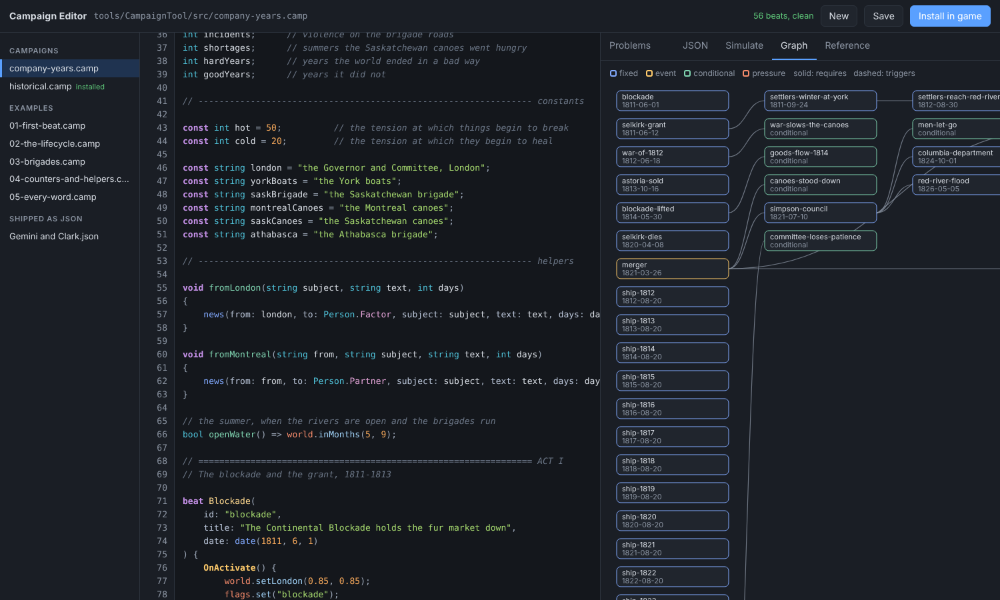
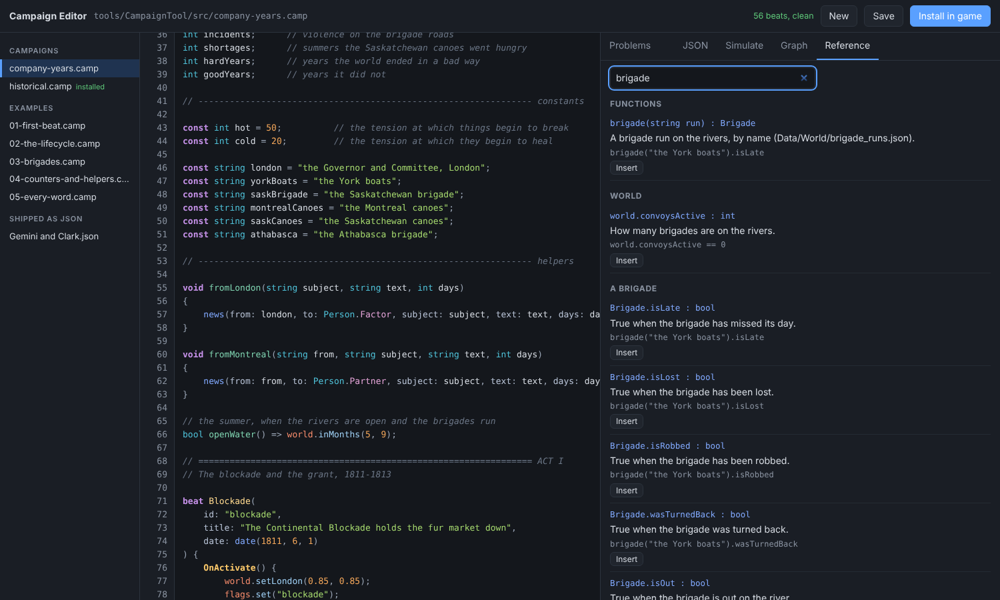

# The web editor

```
dotnet run --project tools/CampaignTool -- serve
```

opens an editor at <http://localhost:8765/>. It runs on your machine (nothing is sent anywhere), uses the same compiler, checker and simulator as the command-line tool, and edits the real files in the repository.



## The screen

- **Left:** the files. *Campaigns* are the scripts in `tools/CampaignTool/src` (with a green *installed* tag when `Campaigns/<name>.json` exists), *Examples* are the small teaching scripts, and *Shipped as JSON* are campaigns that were written as JSON and have no script yet. Opening one of those *converts* it: you see the same campaign written in the language, and saving writes a new `src/<name>.camp`.
- **Middle:** the script, with line numbers. Errors are underlined in red; the line number goes red too.
- **Right:** five tabs: **Problems**, **JSON**, **Simulate**, **Graph**, **Reference**.

## Highlighting

Colours say what a word *is*, so a misspelling shows up as the wrong colour before the checker says a word:

| Colour | What |
|---|---|
| purple, bold | keywords: `campaign beat const void if else for foreach` |
| teal | types and the named-value families: `int string Company Person Item` |
| gold, bold | the hooks: `OnActivate`, `ResolveWhen` ... |
| blue | library functions: `days`, `date`, `news`, `say`, `brigade` |
| green | *your* functions |
| orange | `world` and `flags` |
| light blue | members after a dot: `.tension`, `.isLate` |
| pink | named values: `HBC` in `Company.HBC` |
| yellow-brown | beat names (everywhere they are used) |
| grey italic | comments |

## As you type

- **Checking.** Half a second after you stop typing the whole script is compiled and checked. The status at the top says *56 beats, clean* or *1 error*. The underlined span is exactly what the compiler objected to; hover over it for the message, or read it in **Problems**.
- **Completion.** Type the start of a name, or press **Ctrl+Space**. After `world.` you get `world`'s members; after `Company.` its values; after `brigade("...").` the brigade's; in a beat's braces, the hooks. **Tab** or **Enter** accepts; **Esc** closes. A line below the list says what the highlighted item is.
- **Hover** over any library word to see its signature, what it does and an example.
- **Enter** keeps the indent (and adds one after `{`); **Tab** inserts four spaces.



## The tabs

**Problems** lists the compile error (if any), the checker's errors and warnings, and, if you tick *show notes*, the gentler notes (a flag that nothing reads). Click one to jump to its line.

**JSON** is what the game will read. *Copy* puts it on the clipboard.

**Simulate** plays the script forward. Pick a world (a scenario from `examples/`; see [Simulation scenarios](Simulation-Scenarios)), an adherence and a seed, press *Play it forward*, and read what happened, when, and how (*on its day*, *by the world*, *forced*...), the beats that never happened, what they did, and the variables at the end. Click a row to jump to the beat.



**Graph** draws the beats left to right, with a line for every *requires* (solid) and every *trigger* (dashed), coloured by kind. Click a beat to jump to it.



**Reference** is the whole language, searchable, with an *Insert* button on every example. It is written from the same table the compiler runs, so it cannot be out of date.



## Saving and installing

- **Save** (or **Ctrl+S**) writes the file. A new script asks for a name and is saved in `tools/CampaignTool/src`.
- **Install in game** saves, then compiles into `Campaigns/<name>.json`, where the game's menu finds it. It refuses if there are errors.

The theme follows your system's light or dark setting.

## Keys

| | |
|---|---|
| Ctrl+S | save |
| Ctrl+Enter | check now |
| Ctrl+Space | completion |
| Tab / Enter / Esc | accept / accept / dismiss a completion |

## What the editor will not do

It does not reformat your script, because the compiler throws comments away and rewriting your file would lose yours. (Opening a campaign that was written as JSON is the one place text is generated for you: the *Decompiler* writes it, and it compiles back to exactly the JSON you opened.)
